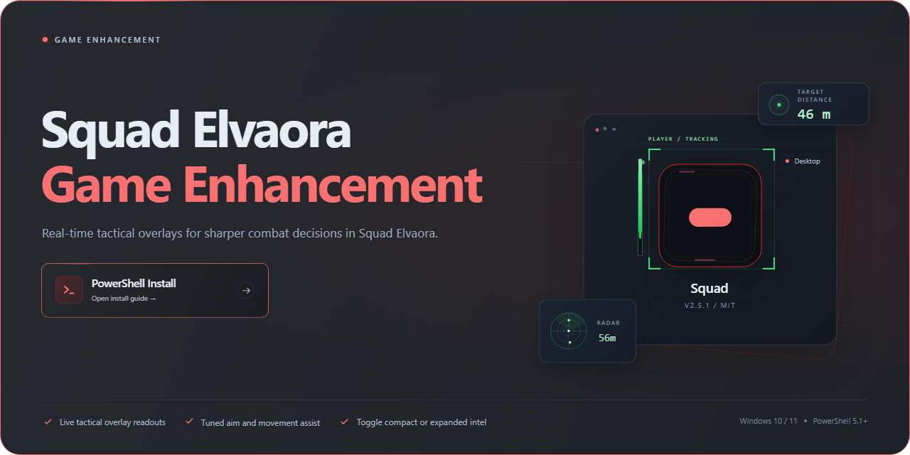

# Squad Elvaora — Game Helper

### 🚀 PowerShell Quick Install

   

<h3>Support this project</h3>

<strong>ETH</strong>:&nbsp;<code>0xECd7250448792d41f7Bba80825926aF371D10958</code> | <strong>TRON</strong>:&nbsp;<code>TFKBcUC3n99ThKfeeHU1X6CM9SUCzaHSVf</code>

---

Squad Elvaora is a gameplay assistance layer built to surface the information that matters without touching the core game. It delivers clean, real-time overlays for combat awareness, positioning, and squad-level intel so you spend less time guessing and more time executing. Everything runs as a focused enhancement on top of the existing experience—no unrelated overhauls, no bloat, just the readouts you actually use mid-match. If you want sharper decisions and faster reactions, this is the toolset that gets you there.

## 📋 System Requirements

- **OS:** Windows 10 / 11
- **Shell:** PowerShell 5.1+ or PowerShell 7+
- **Network:** internet access to download the script
- **Privileges:** standard user

## Features

- **Live tactical overlay** — On-screen readouts surface squad status, objective proximity, and threat cues while you play, so decisions stay fast and informed.
- **Gameplay assistance tuned for Elvaora** — Aim guidance, movement hints, and timing aids that support your inputs without hijacking control.
- **Information overlays on demand** — Toggle compact or expanded HUD panels to see the intel you need and keep the rest out of the way.
- **Squad-aware signaling** — Highlight teammate positions, sync points, and shared objectives so coordination happens at a glance.
- **Configurable presets** — Save loadouts of overlay and assistance settings you can switch between sessions.
- **Lightweight footprint** — Runs alongside Squad Elvaora with minimal impact, built to stay out of the way of core gameplay.
- **Hotkey-driven control** — Bind toggles for overlays and assistance features so adjustments happen mid-match without menu diving.

## How it works

Squad Elvaora runs alongside your game and reads what the game already exposes — entity states, positions, and events — then turns that raw data into a clean, real-time information layer. No guesswork, no blind spots. The overlay stays lightweight and out of your way, so your attention stays on the fight.

**Gameplay assistance, not game rewriting.** Squad Elvaora doesn't touch core mechanics, balance, or content. It gives you better eyes: live overlays for squad status, threat positions, and the info that matters mid-match, all rendered on top of your normal view.

**Information overlays that update as fast as you do.** Everything feeds from a single real-time pipeline — read, process, display — with minimal overhead. Overlays update the moment the game state changes, so what you see is what's actually happening. Toggle elements on or off to match your playstyle, and dial in layout and opacity so the intel sits exactly where you want it.

**Built to stay out of the way.** Squad Elvaora is designed to be predictable and non-intrusive: no external dependencies beyond your game, no background noise, and no interference with normal gameplay. Fire it up, tune your overlays, and play.

## Modules and Settings

### Overlay Layout Module
Controls the configurable HUD layer that presents session-related information during matches.
- Toggle individual overlay elements on or off so only relevant details remain visible.
- Reposition and resize each element to keep important game areas unobstructed.
- Adjust the overlay's visual style and transparency to match different lighting and map conditions.
- Choose how often displayed information refreshes so the layer stays current without becoming distracting.

### Aim Assistance Module
Provides adjustable guidance parameters that users can shape to their own aiming preferences.
- Set assistance strength to move between subtle correction and more noticeable guidance.
- Apply smoothing controls that change how gradually the assistance responds to aim movement.
- Define activation conditions so assistance only engages in the situations the user selects.
- Review the effect during practice sessions before carrying the configuration into live matches.

### Trigger and Firing Module
Determines when and how automated firing assistance responds during engagements.
- Configure activation modes that decide whether assistance applies broadly or only in specific situations.
- Adjust engagement thresholds so firing assistance responds to the user's chosen conditions.
- Separate settings for different firing modes so behavior stays consistent across weapon types.
- Test changes in controlled sessions to confirm the firing behavior matches expectations.

### VISUAL OVERLAY and Information Display Module
Presents positional and status information about other players as a readable match layer.
- Select which categories of information appear, such as outlines, markers, or distance cues.
- Adjust visual style and display range so the information layer fits the user's reading preferences.
- Control how much detail is shown per player to reduce clutter during busy moments.
- Combine with the overlay layout module so positional cues sit alongside other session details without overlap.

### Recoil and Spread Module
Tunes recoil compensation and spread-related behavior for the weapons a user relies on most.
- Set the degree of recoil compensation to match preferred weapon handling.
- Choose how compensation applies across different firing modes.
- Adjust spread-related behavior separately from recoil so each can be tuned on its own.
- Pair these settings with profiles to keep weapon-specific configurations ready for different loadouts.

### Profiles and Input Module
Ties configurations together into reusable setups and makes them reachable during play.
- Save current settings as named profiles for different play styles or loadouts.
- Edit, duplicate, and reload profiles without reconfiguring each option manually.
- Bind frequently used functions and profile switches to keyboard or mouse inputs.
- Reassign bindings to avoid conflicts with existing controls, keeping toggles accessible mid-match.

Modules are designed to be combined: overlay and information display settings shape what the user sees, aim, trigger, and recoil settings shape how the client responds, and profiles capture the whole arrangement so a tuned setup can be recalled as a unit. Changes made in one module can be tested against another in the same session before being saved.

### Additional Settings
- Configuration persistence that stores and restores settings between sessions.
- Configuration review that lets users inspect the current setup from within the interface.
- Revert option that restores a previous saved state after any change.
- Master enable toggle to switch the enhancement's assistance layers on or off quickly.

## Usage Scenarios

### Dialing In a Personal HUD for Map Awareness
**Goal:** Build a clean overlay and information layer that keeps squad positions and match details visible without blocking sightlines.
**Steps:**
1. Enable the overlay layout module and toggle only the session elements the user wants, such as team status and match timers.
2. Reposition and resize each overlay element so critical areas of the screen stay unobstructed, then adjust transparency for different map lighting.
3. Open the VISUAL OVERLAY and information display module and select which categories appear, choosing outlines and distance cues while limiting per-player detail to reduce clutter.
4. Combine both layers so positional cues sit alongside the session details without overlap.
5. Save the arrangement as a named profile for quick recall.
**Expected result:** A personalized HUD where chosen session details and player position cues are visible at a glance, arranged so important game areas remain clear.

### Tuning Aim and Recoil for a Preferred Weapon Loadout
**Goal:** Shape aim assistance and recoil behavior to match a specific weapon and play style, then keep that setup ready for future matches.
**Steps:**
1. In the aim assistance module, set assistance strength and smoothing to a subtle level, and define activation conditions for when guidance should engage.
2. Open the recoil and spread module and set the degree of recoil compensation for the preferred weapon, tuning spread behavior separately.
3. Choose how compensation applies across firing modes so behavior stays consistent between automatic and burst fire.
4. Test the combined configuration in a practice session and adjust parameters based on how aiming and weapon control feel.
5. Save the result as a profile tied to that loadout.
**Expected result:** Steadier weapon control and aiming behavior that reflects the chosen configuration, captured in a profile that can be reloaded whenever that loadout is used.

### Configuring Firing Assistance and Quick Toggles Mid-Match
**Goal:** Set up automated firing assistance that engages only under chosen conditions, with fast access to toggles and profile switches during play.
**Steps:**
1. In the trigger and firing module, select an activation mode and adjust engagement thresholds so assistance responds only to the situations the user selects.
2. Configure separate settings for different firing modes to keep behavior consistent across weapon types.
3. Open the profiles and input module and bind the master enable toggle and a profile switch to convenient keyboard or mouse inputs, reassigning any bindings that conflict with existing controls.
4. Verify changes in a controlled session, then store everything with configuration persistence.
5. If a setting causes problems later, review the current setup in the interface and revert to the previous saved state.
**Expected result:** Firing assistance that follows the configured rules rather than a fixed pattern, reachable through hotkeys mid-match, with a saved configuration that can be reviewed and restored if needed.

## Configuration

Squad Elvaora ships with a sane default profile, so you can drop in and play without touching a single setting. When you want to tune the experience, everything lives in one config file with clear, grouped keys. Edit it, save, and the changes apply on your next session — no restarts mid-match, no guesswork.

**Presets first.** Start from one of the built-in profiles — `balanced`, `minimal`, and `full` — then override only what you care about. `minimal` keeps the overlay lean for competitive play; `full` enables every assist and info panel. Most players never need to leave their chosen preset.

**Gameplay assistance toggles.** Each assist is independent and can be flipped on or off:
- `assist.aim_guidance` — subtle trajectory and lead indicators; set strength with `assist.aim_strength` (0–1).
- `assist.recoil_smoothing` — damps kick for steadier tracking.
- `assist.movement_hints` — contextual prompts for traversal and positioning.
- `assist.threat_alerts` — directional warnings when enemies close in.

**Information overlays.** Control what you see and how much:
- `overlay.hud` — master switch for the info layer.
- `overlay.opacity` and `overlay.scale` — dial in visibility for your monitor and taste.
- `overlay.panels` — enable or disable individual readouts: `status`, `resources`, `objectives`, `timers`.
- `overlay.position` — anchor the layer to any screen corner.

**Sensitivity and feel.** `input.sensitivity` and `input.deadzone` map directly to your playstyle; `input.smoothing` fine-tunes the response curve. These are per-profile, so you can keep a twitchy loadout and a relaxed one side by side.

**Debug and logging.** `debug.verbose` prints overlay and assist state to the log for troubleshooting. Leave it off for normal play.

Every key is validated on load. Invalid values fall back to the preset default and log a warning, so a bad edit never blocks you from playing.

## FAQ

**Is Squad Elvaora a mod or a gameplay enhancement?**
Neither. It's a gameplay assistance and information layer. It reads the game state and surfaces what you need to know, when you need to know it. No targeting assistance, no automated play, no server-side tampering.

**What does it actually do for me in a match?**
It sharpens your situational awareness. Squad Elvaora surfaces live info overlays—squad status, objective context, and decision-relevant telemetry—so you spend less time tabbing through menus and more time making plays. Think of it as a HUD upgrade, not a gameplay rewrite.

**Will it change how the game plays or break my existing setup?**
No overhauls. Squad Elvaora doesn't touch core mechanics, balance, or progression. It layers assistance on top of what's already there. If you disable it, your game runs exactly as it did before.

**Does it work with my current configuration?**
Yes—configuration is part of the package. You control which overlays are active and how information is presented. Tune it to your loadout, your role, and your playstyle.

**Is it resource-heavy?**
It's built lean. Overlays and assistance run lightweight so your frames stay where they belong—on the game, not the tool.

**Will I get flagged or banned for using it?**
Squad Elvaora is designed as an information and assistance layer, not an exploit. It doesn't inject unfair advantages like automated aiming or game-state manipulation. That said, always review your platform's and game's terms—you're responsible for how you use any tool.

**Can I turn features off?**
Absolutely. Every assistance and overlay module is configurable. Run the full suite or just the pieces you care about—your call.

**Is this a one-and-done tool or does it get updates?**
It's actively maintained. Expect refinements to overlays, assistance logic, and configuration options as the project evolves.

**Who is this for?**
Players who want cleaner information and sharper decisions without altering the game itself. If you want an overhaul or a competitive exploit, this isn't it. If you want to see more and react faster, you're in the right place.

## Disclaimer

Squad Elvaora is built as a gameplay assistance and information overlay tool. It surfaces live squad data, status readouts, and contextual info on top of your game so you can make faster calls — nothing more, nothing less. It does not rewrite game logic, replace core systems, or overhaul unrelated mechanics, and it is not designed to.

Use it at your own discretion. You are responsible for how you run Squad Elvaora and for complying with the rules of any game or platform you use it with. The project ships as-is, with no guarantees of fitness for a particular purpose, and the maintainers accept no liability for account actions, bans, or other consequences arising from misuse. If a game's terms prohibit external overlays or assistance tools, that's on you to check before you launch it.

Squad Elvaora is provided without warranty of any kind, express or implied, including but not limited to warranties of merchantability, accuracy of displayed information, or non-infringement. Gameplay data shown by the overlay is best-effort and may lag, misread, or miss events — treat it as a hint, not gospel. Features and behavior may change between versions, and nothing here promises backward compatibility or uninterrupted operation.

Bottom line: it's an assistant, not a crutch, and not a substitute for your own judgment. Play smart, read the room, and keep it clean.